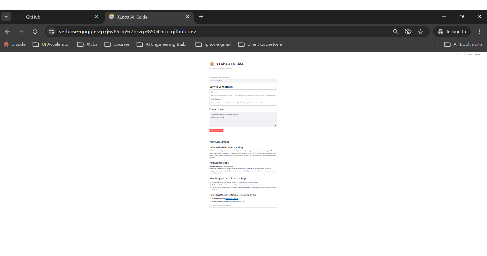

# XLabs AI Guide

XLabs AI Guide is a Kubernetes troubleshooting learning assistant. It assesses the diagnostic reasoning a learner explicitly demonstrates, distinguishes misconceptions from checks they have not mentioned, and suggests next steps grounded in local Kubernetes documentation.



## Problem

Learners may know Kubernetes terminology without being able to apply it to a failure scenario. Generic answers can obscure what they understand, what they have not yet checked, and what they should learn next. XLabs focuses on troubleshooting scenarios and gives evidence-based, documentation-grounded feedback rather than a score for the learner.

## Architecture

```text
Learner
  -> Streamlit app (app.py)
  -> Agent (agent.py; OpenAI Responses API)
  -> Local tools (tools.py)
       search_docs -> search the local documentation index
       read_doc    -> retrieve a full documentation record
       get_scenario -> retrieve a saved scenario by ID
  -> Assessment with understanding, gaps, next steps, and sources
```

The knowledge base is stored locally in `data/kubernetes_troubleshooting_docs.json` and `data/kubernetes_scenarios.json`. `tools.py` builds a Minsearch index over the documentation records and implements the three tools exposed to the agent. The model is instructed to distinguish scenario facts from the learner's own reasoning and to ground technical guidance in retrieved documentation.

The Streamlit app calls `agent()` without enabling structured output, so its production-facing assessment is text-based. `agent.py` also contains an opt-in Structured Output path (`structured_output=True`); it is experimental and is not used by the app. The separate PydanticAI and structured-capture experiments are not part of the app's submission behavior.

The included [Streamlit screenshot](xlabs-ai-guide-streamlit-assessment.png) shows the assessment interface. This is a local application; no cloud deployment is claimed.

## Setup and run

Requirements: Python 3.13 or newer, [uv](https://docs.astral.sh/uv/getting-started/installation/), and an OpenAI API key.

```bash
git clone https://github.com/snap7979/xlabs-ai-guide-buildcamp.git
cd xlabs-ai-guide-buildcamp
cp .env.example .env
```

Add your `OPENAI_API_KEY` to `.env`, then install dependencies and start the app:

```bash
uv sync
uv run streamlit run app.py
```

Choose a Service Connectivity, Pod Troubleshooting, or DNS Resolution scenario, enter a troubleshooting approach, and submit it for assessment. Agent requests use the OpenAI API and may incur charges.

## Testing

The offline tests check that `get_scenario` returns the expected saved scenario from local data and that the Agent assembles its instructions correctly with a fake client. Run those checks, the API-backed Agent test, the Agent + LLM Judge test, or all tests with:

```bash
uv run pytest -q tests/test_tools.py
uv run pytest -q tests/test_agent_instructions.py
uv run pytest -q tests/test_agent.py
uv run pytest -q tests/test_judge.py
uv run pytest -q
```

`test_tools.py` only uses local data, and `test_agent_instructions.py` uses a fake Responses client; both avoid API calls and do not require an API key or network access. `test_agent.py` and `test_judge.py` call the OpenAI API, so they require a valid `OPENAI_API_KEY` and network access and may incur paid API charges. The full test command includes those API-backed tests and has the same requirements.

The offline checks for `tests/test_tools.py` and `tests/test_agent_instructions.py` passed together in the earlier Step 4B run: **2 passed in 3.25s**. In the later Step 7 verification, the complete Git index was exported with `git checkout-index --all` to a fresh directory outside the repository. In that snapshot, `uv sync --frozen` succeeded and installed 187 packages, then the same two offline tests passed: **2 passed in 4.33s**. The snapshot contained no `.env` file, and OpenAI- and Logfire-named environment variables were removed from the test process. The original repository status, staged manifest, staged diff fingerprint, and tracked worktree diff fingerprint were unchanged. uv warned that hardlinking was unavailable and copied files instead. This verifies installation and offline tests from the exact staged snapshot; Step 7 did not launch the Streamlit app or verify live OpenAI API operation.

## Offline retrieval evaluation

The separate retrieval evaluation calls the local `search_docs()` function directly, without invoking the Agent or making OpenAI calls. Its runner is `evals/retrieval/run.py`, its labeled queries are in `evals/retrieval/data/queries.json`, and the saved methodology and results are documented in [the retrieval evaluation report](evals/retrieval/EVALUATION_REPORT.md). Run it with `uv run python -m evals.retrieval.run`.

The documented baseline is **2/3 Top-1 (66.7%) across three queries**. The Service-routing query is the miss: `debug-services` ranks third rather than first. The report also includes two exploratory Service-query reformulations, separate from the baseline metric. This small corpus and query set do not establish broad retrieval quality or paraphrase robustness.

## Week 6 manual evaluation

The manual evaluation follows the core workflow of comparing model-judge assessments against human-reviewed labels:

1. Run the agent over the scenarios and save results.
2. Review and label selected agent assessments.
3. Run the LLM judge on the reviewed cases and inspect disagreements.

The saved scenario set contains **51 cases**. `evals/manual/data/results_labeled.json` contains **25 human-reviewed labels**: 24 `good` and 1 `bad`. The number of reviewers and any independent or inter-rater review process are not documented; these labels should not be described as independently verified.

The saved judge output, `evals/manual/data/judge_evaluated.csv`, covers all 25 reviewed cases. It agrees with the human labels on **24/25 cases (96%)** and disagrees on one:

- Human label: `good`; judge label: `bad`.
- The learner mentions testing name resolution and verifying the namespace.
- The judge reasoning treats omitted Service selector and endpoint checks as a misconception, while the human comment considers the stated checks valid and recommends those other checks as next steps.

This is a small, imbalanced sample (only one human-labeled `bad` case); the accuracy is descriptive, not evidence of robust performance. The disagreement also shows a limitation of the judge: it can penalize an incomplete answer as though it demonstrated an incorrect belief.

The project owner's earlier execution record reports an iteration from **22/25 agreement (88%)** to **24/25 (96%)** after revising the judge prompt. It also reports that the revised judge correctly flagged the fabricated-sources assessment case. The final saved CSV independently supports the 24/25 result and retains the one disagreement described above.

The historical comparison has an evidence limitation: the initial V1 result file is not independently preserved in the current tracked repository, and the original prompt diff cannot be verified from the saved artifacts. Accordingly, the 88% → 96% change is attributed to the project owner's earlier execution record, not independently reconstructed from Git or distinct saved V1/V2 outputs.

### Reproduce the manual evaluation

Running the agent or judge invokes the OpenAI API and may incur charges. The agent runner writes `results.json`, and the judge runner overwrites `judge_evaluated.csv`; preserve outputs you need before rerunning. The manual label-review UI reads and writes local files.

```bash
# Run all scenarios, or limit the run while developing
uv run python -m evals.manual.run
uv run python -m evals.manual.run --limit 5

# Review saved agent results in the manual labeling interface
uv run streamlit run evals/manual/app.py

# Run the judge against human-reviewed cases
uv run python -m evals.manual.run_judge
```

The judge runner selects cases with `good` or `bad` human labels from `results_labeled.json`, writes `judge_evaluated.csv`, and prints agreement metrics and disagreements.

## Monitoring

`agent.py` configures Logfire, instruments the OpenAI client, and records an assessment-session span plus spans for tool calls. The [Logfire agent monitoring dashboard](https://logfire-eu.pydantic.dev/xlabs/xlabs-ai-guidestarter-project/dashboards/x-labs-ai-guide-agent-monitoring) was historically verified on **October 26, 2026**. That verification reported **42 LLM calls**, **2.735 seconds average duration**, **40.04K input tokens**, and **4,919 output tokens**. These are historical figures from that prior dashboard verification, not a new live measurement; they do not establish that a deployment is currently running or that traces are still being collected. Access may require Logfire authentication and project configuration.

## Capstone self-assessment

This is an evidence map against the official capstone areas, not an official score. Status distinguishes what is implemented, what is documented in this repository, and what was independently verified; it does not claim independent project review.

| Capstone area | Evidence | Status |
|---|---|---|
| Problem and user value | Focused problem: help Kubernetes learners separate demonstrated reasoning from misconceptions and unmentioned checks. | Problem and intended use are documented; user outcomes are not independently evaluated here. |
| Solution and architecture | OpenAI Responses API agent, local Minsearch retrieval, three tools, local knowledge base, and Streamlit interface. | Implemented and documented; cloud deployment is not evidenced. |
| Data and knowledge base | Local Kubernetes troubleshooting records with source links and saved scenarios. | Included in the repository; source coverage and completeness are not independently audited here. |
| Testing | Two offline tests passed from the exact staged Git-index snapshot (2 passed in 4.33s after `uv sync --frozen`; 187 packages installed). Other agent/judge tests make API calls. | Step 7 verified snapshot-local dependency installation and offline tests without `.env`; it did not run API-backed tests or launch the app. |
| Evaluation | 51 scenarios, 25 human-reviewed labels, saved judge output, one remaining disagreement, and the owner-reported 88% → 96% iteration. | Current final result is saved; initial V1 result and original prompt diff are not independently preserved. Reviewer independence is undocumented, and the sample is small and imbalanced. |
| Monitoring | Logfire spans and the historical dashboard verification with dated call, duration, and token figures. | Instrumentation is implemented; figures are historical, not a current measurement. |
| Reproducibility | The exact staged Git-index snapshot installed from `uv.lock` and passed the two offline tests in a fresh external directory. | Live Streamlit and OpenAI API operation were not verified; API-backed runs require credentials and may incur charges. |

## Project files

- `agent.py` — default text Agent, OpenAI Responses API loop, and Logfire tracing; also contains an opt-in experimental Structured Output path not used by the app.
- `tools.py` — local retrieval index and the `search_docs`, `read_doc`, and `get_scenario` tools.
- `app.py` — learner-facing Streamlit application.
- `data/` — Kubernetes documentation records and saved scenarios.
- `evals/manual/` — scenario runner, human-labeling interface, judge, and saved evaluation data.
- `tests/` — unit and agent/judge tests.
